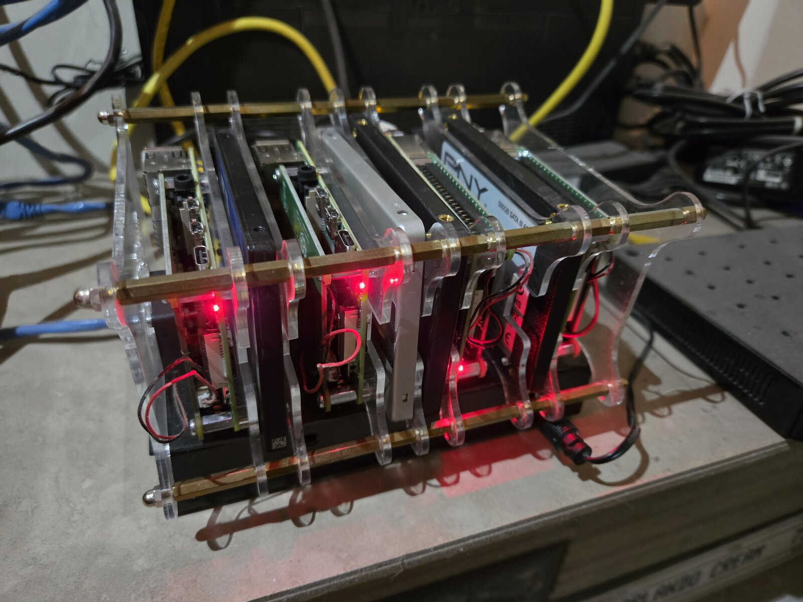
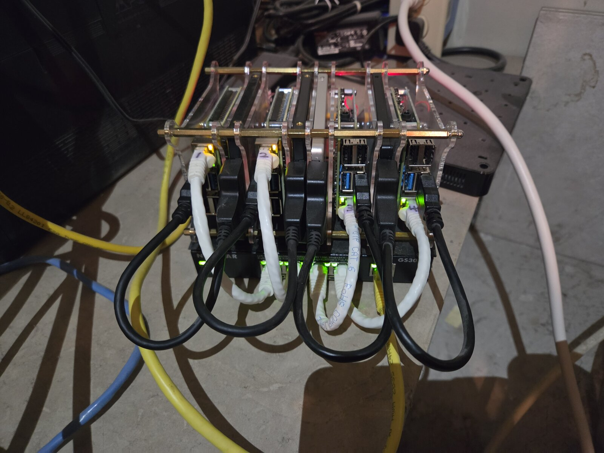
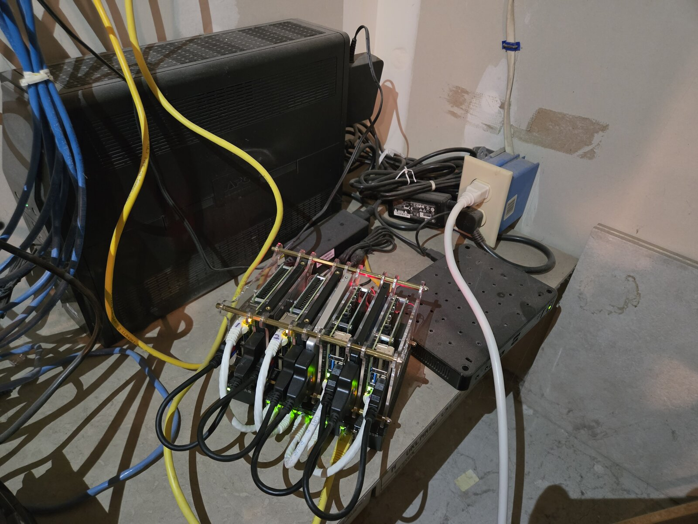

Yesterday I ended my last post with a plan: ship the post, rotate the DDNS
password, and rebuild the cluster rather than drag a frozen 2021 stack through
~25 upgrade hops.  All of that happened — including the parts nobody plans for.

## The rebuild

- **Repo first (A1).** Retargeted the pins to what's current: k3s
  `v1.36.6+k3s1`, Longhorn `1.13.0`, MetalLB `0.16.2`, Traefik chart `42.4.0` /
  `v3.7.18`, Prometheus `29.47.2` / `3.16.0`, Grafana `14.4.1` / `13.3.1` (the
  Grafana chart quietly moved repositories in January).
- **Ran the preservation gate, then wiped all four disks.** With no rollback,
  the gate had to pass *before* anything was erased: site content archived and
  verified byte-identical to git, ACME state saved, passwords rotated.
- **Ubuntu Server 26.04.1 LTS** on every node (kernel 7.0, cgroup v2,
  netplan), then k3s: a server on `kube1` plus three agents, all `Ready`
  within minutes of the first `curl | sh`.
- MetalLB with the pool pinned to `.201` by annotation, Longhorn, Traefik,
  Prometheus and Grafana followed from the same repo manifests — no hand
  edits.

## Five defects the rebuild flushed out

This is the part I want on the record: every one of these only shows up when
you actually *run* the thing.

1. **Chart 42 runs `runAsNonRoot` at the pod level.** The Traefik
   `volume-permissions` init container inherited uid 65532 and could not chown
   a root-owned Longhorn volume — Traefik looped in `Init:Error` until I pinned
   that one container back to uid 0.
2. **Traefik v3 accepts one hostname per `Host()`.** My `containo.us` →
   `traefik.io` migration validated the CR *fields* but never the rule
   *expressions*, so every multi-host route silently failed to parse and all
   the public hosts returned 404. Fixed with OR chains, plus parentheses
   wherever a `PathPrefix` followed.
3. **`nfs-common` is required to mount RWX.** I had argued it out of the docs
   myself — the share-manager does serve NFS from inside the cluster, but the
   mount happens on the node. `mysite-content` sat in `ContainerCreating` with
   `mount failed: exit status 32` until `apt install nfs-common`.
4. **MetalLB 0.16 moved metrics to HTTPS with bearer-token auth**
   (kube-rbac-proxy is gone). The vendored manifest still advertised plain-HTTP
   annotations and had no TokenReview grants, so five targets were permanently
   down. It took five separate causes to pin down — including my first RBAC
   attempt using the wrong apiGroup, and camelCase relabel fields that
   Prometheus rejects outright.
5. **Traefik's RWO `acme.json` deadlocks `RollingUpdate`** — the new pod waits
   for a detach the old pod will never make while `maxUnavailable: 0` keeps it
   alive. Hit it twice, each needing a manual pod delete before `Recreate`
   fixed it for good.

All five are fixed in the repo (PRs 18–22), with the symptoms documented next
to the fix.

## Certificates, downtime, and a maintenance page

While the cluster was down I pointed the public names at a small Caddy
maintenance page — which meant every TLS-ALPN challenge hit Caddy and Let's
Encrypt duly rate-limited me.  Flipping the router back to `.201` (and
restart-ing Traefik so it would retry the failed orders) produced **valid
certificates for all eight hostnames** within a minute.

Final state: Prometheus **24 targets up, 0 down** (now including MetalLB's
five), 15 Longhorn replicas healthy, site content byte-identical to git, and
the blog untouched at image `1.0.5`.

## Credentials and loose ends

- `authsecret` and the Grafana password were rotated *before* the wipe, so the
  old values died with the old cluster.
- The Park-Your-Domain password rotated after — and **Namecheap requires a
  unique password per domain**, which killed the "one shared key for both
  domains" shortcut and gave us two Secret keys instead.
- The dynamic-DNS API returns HTTP 200 with `<ErrCount>1</ErrCount>` when the
  password is wrong, so a CronJob reports `Complete` while failing.  Read the
  logs for `ErrCount`, never the job status.
- Every P0 action item is closed, including the stray `k3s.service` on `kube2`
  that had restarted 1.58 million times — moot after the reimage.

## Host tuning, back where it was

Restored what the old nodes had: Wi-Fi and Bluetooth off at the firmware
level, `wpa_supplicant` disabled (the image had it running with a process to
manage no interface), and the **2.0 GHz overclock with `over_voltage=6`**.
Settled temperatures rose only 1–3 °C with `get_throttled` pinned at `0x0` —
heatsinks and active cooling earn their keep.  `kube1` went last on purpose:
it is a single control-plane server on embedded SQLite, so its reboot takes the
API down with it.  That single point of failure is a documented, deliberate
trade-off for now (and yes, HA would mean three servers with etcd, or an
external datastore).

## The homepage too

The dead pi-hole link is gone from [devinflake.com](https://devinflake.com/)
(its DNS record was deleted), and the 2019 rack photo now sits beside the
Raspberry Pi logo.

## Next: Argo CD

All four Argo CD gates are marked satisfied — Kubernetes inside its tested
range, add-ons migrated, nodes `Ready`, workloads reachable over HTTPS — so
phase 6 is the next post: bootstrap Sealed Secrets, install Argo CD, point it
at `master`, and finally stop running `kubectl apply` by hand.

The full before-and-after, including the rebuild history, lives in
[the repo's cluster status](https://github.com/flakeman2/raspberry-pi-dramble/blob/master/docs/cluster-status.md).
