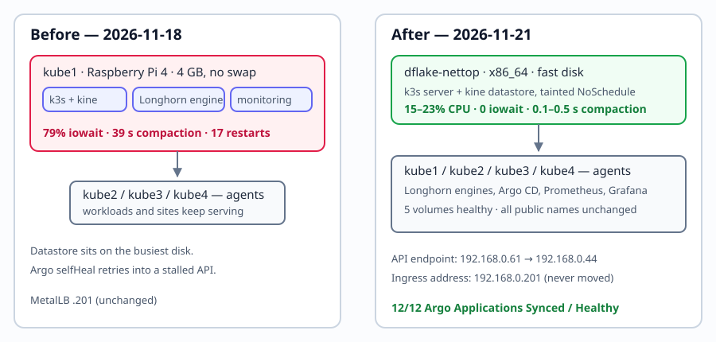
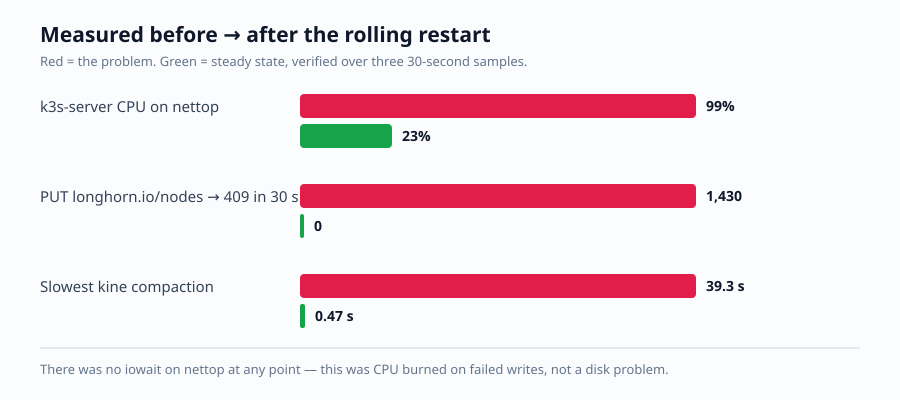
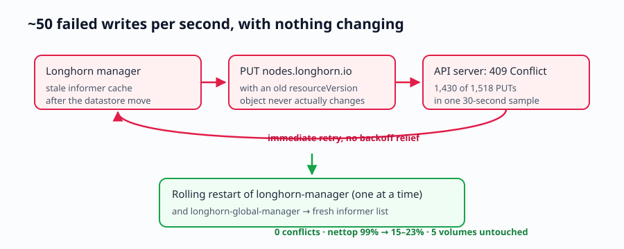

The little cluster had been up for five days and the API was disappearing every
ten to twenty minutes. By the evening of 2026-11-18, `kube1` had restarted k3s
**17 times** — 16 of them that day. Pods kept serving, sites stayed up, and
then `kubectl` would simply stop answering for a minute. That is a very
specific kind of uncomfortable.

This is the story of moving the control plane to a different machine, and of
the second, unrelated problem that only showed up *after* the move.



## First, read the evidence

The obvious suspect was Argo CD. I had just put twelve Applications on automatic
sync with self-heal, and every time the API stalled they all retried against a
server that could not answer. More load begets more load, so I denied automated
sync on both AppProjects and gave myself a breathing window.

That was the right *first* move, but it was not the cause. The logs said:

```
Slow SQL: DELETE ... name=Compact   duration=39.27s
level=fatal  msg="Transaction commit failed: sql: transaction has already been committed or rolled back"
```

k3s uses **kine** — SQLite translated into an etcd-shaped API — in process, on
the server node. `kube1` is a 4 GB Raspberry Pi with no swap, and it was running
the datastore, the Longhorn engine, and the monitoring stack on one disk.
Measured at the time: **79% iowait**, load 20–27 sustained, and both
`longhorn-manager` and `argocd-application-controller` stuck in **D state**
(uninterruptible I/O sleep). Argo's controller was using about 1.6% of a core.
It was a bystander.

So the fix was not to tune SQLite, and definitely not to delete Argo. The fix
was to get the datastore off the contended disk.

## The move, in one careful sequence

There is deliberately **no off-cluster Longhorn backup** in this cluster. Five
volumes hold the sites and monitoring history, and the `Volume`, `Snapshot` and
`Backup` objects that describe them live *inside that SQLite file*. A
control-plane migration is therefore a datastore migration: the highest-risk
operation I can perform here.

1. Stop k3s on `kube1` so the write-ahead log was quiesced, then archive
   `/var/lib/rancher/k3s/server` — the database, the CA, the certs and the join
   token. Keep an untouched copy on the old node.
2. Install k3s on `dflake-nettop`, an always-on x86_64 box on the same LAN with
   a fast disk. Crucially: **tainted** `NoSchedule`, and installed with
   `SKIP_START`/`SKIP_ENABLE` so it could not initialise an empty cluster before
   I restored the real one.
3. Restore the archive, delete the old apiserver certificate so it gets
   reissued for the new address, and start it. `/readyz` returned `ok`; all five
   Longhorn volumes came back attached and healthy.
4. Disable the server unit on `kube1`, retire its state directory, and rejoin
   all four Pis as agents pointing at the new API. Then repoint the admin
   kubeconfig — the CA survived, so only the URL changed.

One thing that did **not** change: `192.168.0.201`. That is a MetalLB address
announced by the Pis for Traefik, not the API endpoint. Nothing in DNS or on the
router needed touching, and the public sites never moved. Only
`192.168.0.61:6443 → 192.168.0.44:6443`.



## Then nettop's CPU hit 99%

Five minutes after the cutover, the new server was pinned to two cores. This
looked exactly like the old failure repeating itself, which is a good way to
make a bad decision quickly.

I checked the easy things first. iowait over six seconds: **zero**. Kine
compactions: **104–467 milliseconds**, against 39.27 seconds on the Pi. No
`fatal` lines, no slow-SQL warnings. It was not the datastore.

The API server's own request counters gave it away:

```
1518  PUT  longhorn.io/nodes   in 30 s
1430  of them returned 409 Conflict
```

And the object's `resourceVersion` did not move. A stale informer cache in the
Longhorn controllers — left over from the datastore swap — was writing an old
resource version, getting rejected, and retrying immediately. Roughly fifty
failed writes a second, with none of them changing anything. **94% of those
writes were conflicts.**



This is where I nearly reached for the bigger hammer. Would etcd be better
than SQLite? For this failure, no: a single-node etcd adds raft, fsyncs and its
own compaction on top of the same fifty writes a second. It would make the loop
more expensive, not less. The datastore was never the problem.

The fix was a rolling restart of `longhorn-manager` — one pod at a time, waiting
for each to come back — and `longhorn-global-manager`. Fresh informer lists,
fresh resource versions. Conflicts went to **zero**, CPU dropped to **15–23%**,
and all five volumes stayed healthy throughout.

## Turning Argo back on

With the API steady and the loop gone, the emergency holds had served their
purpose and were actively in the way: `longhorn` had been registered as an
Application but had never synced, so it sat `OutOfSync` behind the deny window.

I synced it manually while the hold was still in place, watched the metrics for
four minutes (zero 409s, about 80 writes in 30 seconds total), then cleared the
window on the `default` AppProject and watched again. Both holds came off once
I had evidence that nothing came back.

The steady-state cost of Argo here is almost funny: the application controller
uses **11 millicores and 264 MiB**, and writes to Applications about three
times every thirty seconds. The Longhorn loop it had been blamed for was fifty
writes *per second*. There is no reason to rethink Argo CD on this cluster —
the two incidents were a slow Pi disk and a stale storage controller cache.

All twelve Applications are now `Synced` / `Healthy`, with self-heal restored.

## What I take from it

- **A hold is not a fix.** It buys time to measure. If you leave it in place,
  drift quietly accumulates behind it.
- **Measure before choosing the datastore.** iowait, compaction timings and the
  API's own request counters separated "disk is slow" from "controller is
  looping" in minutes.
- **A 409 is a signal, not noise.** A high conflict rate means something is
  retrying against state it no longer agrees with. Restarting the controller
  is cheaper than rebuilding the cluster.
- **Keep the control plane boring.** The new server is tainted, so even Argo
  stays on the Pis. Nothing competes with the database for that disk.

The full operator runbook, including the exact commands and the rollback
details, is in
[`docs/control-plane-migration-nettop.md`](https://github.com/flakeman2/raspberry-pi-dramble/blob/dev/docs/control-plane-migration-nettop.md).
The measured failure evidence and the follow-up items are in
[`docs/action-items.md`](https://github.com/flakeman2/raspberry-pi-dramble/blob/dev/docs/action-items.md).

## How this was written

A large part of this work was produced with AI assistance. The agent used was
**MiMo-V2.6-Flash** (model ID `mimo-v2.6-flash`), running in OpenCode, and it
did the bulk of the implementation: analysing the logs, writing the migration
runbook, driving the verification commands, updating the repository docs and
drafting this post.

**I read and verified all of it myself before publishing.** Every claim here —
the restart counts, the 39.27-second compaction, the 1,430 conflicts, the CPU
figures, the volume health and the final Application states — was checked
against the cluster, the logs or the repository rather than taken on trust. The
decision to reject etcd, and the choice to restart the Longhorn controllers
instead, were mine after reading the measurements.

---
*The three diagrams in this post were drawn for it and contain no third-party
artwork; see [`assets/images/CREDITS.md`](https://github.com/flakeman2/Ephesus/blob/master/assets/images/CREDITS.md).*
