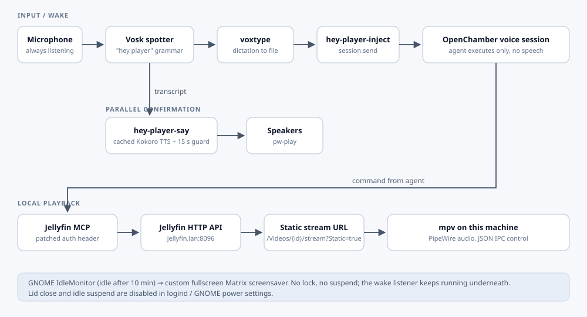

I wanted one sentence to be enough. From across the room: “Hey Player, play dark
techno.” No keyboard, no phone, no hotkey. Music would start locally from the
Jellyfin server on my LAN, and a spoken confirmation would come back quickly
enough to feel like the machine had been waiting for me.

AI models discussed: OpenCode's Big Pickle LLM

The result is a small pile of scripts on a GNOME/Wayland laptop. A wake-word
spotter listens all the time. A dictation model transcribes the command. An agent
in a dedicated OpenChamber session does the work. A separate text-to-speech path
answers first. The measured fast path is **2.62 seconds to the start of the
spoken confirmation** and **2.89 seconds to command injection** — the answer
arrives before the agent is finished.



## The one design decision that mattered

After the transcript exists, the flow splits in two:

1. **Execution** — inject the transcript into the voice session. The agent
   resolves aliases, calls the Jellyfin helpers, and drives mpv.
2. **Confirmation** — map the transcript to one of a handful of canonical
   sentences and speak it from a cached audio file, without waiting for the
   agent.

That split is the whole trick. My first version asked the agent to speak its own
reply. It worked, but the reply landed after the model had thought, called tools,
and written text. It felt slow, and a stale agent-side TTS call sometimes
produced a duplicate confirmation. The new contract is blunt: **the listener
speaks; the agent acts and replies in chat.** A 15-second duplicate guard catches
anything that slips through.

## Jellyfin fought back a little

The server was a Jellyfin 12.4.0 instance on the LAN. Credentials stayed in a
private env file and were read at runtime; nothing secret went into a script, a
config file, or this post.

Two API surprises cost me an evening:

- A trailing slash in `JELLYFIN_URL` produced `404` responses. Normalize with
  `rstrip("/")` before building any URL.
- `X-Emby-Token` returned `401`. This server wanted
  `Authorization: MediaBrowser Token="..."`, with client and device metadata
  attached:

```python
headers = {
    "Authorization": (
        f'MediaBrowser Token="{api_key}", '
        'Client="JellyfinMCP", Device="OpenCode", '
        'DeviceId="opencode-jellyfin-mcp", Version="1.0"'
    )
}
```

That required a two-file patch to the cloned `jellyfin-mcp` checkout: the HTTP
service and the websocket service. The patch is included in the archive.

One more quirk: the library contained no `Audio` items at all. The music lived
in `MusicVideo` items, so the resolver accepts both types and builds static
stream URLs like:

```text
http://jellyfin.lan:8096/Videos/{id}/stream?Static=true
```

Album, artist, playlist, and folder IDs are expanded into their playable
children before playback starts.

## Local playback is mpv plus a socket

`jellyfin-play-local` resolves search text, item IDs, albums, playlists, or
folders through the Jellyfin API and launches mpv with the resulting URLs. The
defaults are deliberately boring: volume 100, audio only, no shuffle, no loop.

| Flag | Behavior |
| --- | --- |
| *(default)* | volume 100, `--no-video`, no shuffle, no loop |
| `--video` | show video for `MusicVideo` items |
| `--volume N` | initial volume |
| `--shuffle` | randomize resolved items |
| `--loop` | `--loop-playlist=inf` |
| `--pause`, `--ao`, `--limit`, `--dry-run` | start paused, choose output, cap results, resolve only |

A second helper, `jellyfin-mpv-control`, talks to mpv over a JSON IPC socket at
`/tmp/opencode-jellyfin-mpv.sock`:

```bash
jellyfin-mpv-control <pause|play|toggle|stop|next|prev|volume N|seek N|status|quit>
```

Audio goes through PipeWire. I verified playback, pause/resume, track skipping,
volume changes, and stop end to end. The alias table used by the agent stayed
small and human-readable: “dark techno,” “epic,” “soft,” and “synth” mapped to
four library folders, with no raw item IDs needed in spoken commands.

## The wake word and the transcript

`hey-player-listener` is a long-running user service. It captures 16 kHz mono
audio from PipeWire with `pw-record` in 125 ms chunks and feeds a Vosk grammar
recognizer using the small English US model. The grammar contains only the wake
variants — “hey player,” “hay player,” “hey players,” “hey play er” — plus an
unknown token. That keeps the always-on recognizer cheap.

The snappy feeling comes from **partial-result detection**. As soon as recognizer
output starts with “hey play,” the listener treats it as a wake and starts
recording the command. After a wake: an 8-second cooldown, a 6-second recording
window, and a 15-second transcript timeout.

Dictation is handled by voxtype with the `base.en` Whisper model. Its hotkey is
disabled; the listener starts and stops recording externally and reads the
transcript from a file. The timing knobs that mattered were a 1.5-second
silence timeout and a `-12 dBFS` speech threshold.

One detail is worth calling out because the example config is misleading. The
bundled `voxtype-config.toml` shows a fixed `output.file_path` of
`/run/user/1000/hey-player/command.txt`. That file is an **example/default**. The
running listener is authoritative: for each wake it creates a unique path under
`$XDG_RUNTIME_DIR/hey-player/`, unlinks any stale file, passes that path with
`voxtype record start --file=...`, and polls it for the transcript. If you adapt
this build, follow the listener.

## Speaking before the agent finishes

`hey-player-say` calls OpenChamber's local text-to-speech endpoint with the
`kokoro-en-v0_19` model and plays the returned audio through `pw-play`. The
cache lives under `~/.cache/hey-player/tts`; its key includes the text, speaker,
and speed, so the common confirmations are effectively prewarmed.

The listener maps a transcript to a canonical sentence before it injects
anything:

| Heard | Spoken confirmation |
| --- | --- |
| pause / stop | “Pausing the music.” / “Stopping the music.” |
| next / skip | “Playing the next track.” |
| previous / back | “Playing the previous track.” |
| dark techno | “Playing dark techno music from Jellyfin.” |
| volume 40 | “Setting volume to 40 percent.” |

Unknown commands get “Sorry, I didn't catch a playable command.” rather than
silence. The spoken answer is deliberately narrow; the agent is still free to
interpret the full transcript.

Measured after the wake:

| Event | Time after wake |
| --- | ---: |
| Confirmation starts | **2.62 s** |
| Command injected | **2.89 s** |

## Getting the words into the session

`hey-player-inject` sends a `session.send` action to the local OpenChamber
agent-tool endpoint. The session ID lives in a private file; the archive only
contains a placeholder. The payload looks like this:

```json
{
  "input": {
    "action": "session.send",
    "sessionId": "ses_REPLACE_WITH_YOUR_SESSION_ID",
    "prompt": "Hey Player: play dark techno"
  },
  "sessionID": "ses_REPLACE_WITH_YOUR_SESSION_ID",
  "callID": "hey-player-<timestamp>",
  "tool": "openchamber"
}
```

The injector first tries to discover the endpoint and token from the running
OpenChamber process environment, then falls back to a private env file. I also
kept a manual fallback: `Super+Alt+V` runs `hey-player-manual`, records one
command, and injects it through the same path.

I did try `opencode run` for injection. It failed with a free-usage-limit error,
so the session tool is the supported route here.

## Keeping the laptop available

An always-listening remote is useless if the laptop suspends or locks. The final
settings are intentionally aggressive:

| Setting | Value |
| --- | --- |
| `org.gnome.desktop.session idle-delay` | `0` (GNOME never blanks) |
| `org.gnome.desktop.screensaver lock-enabled` | `false` |
| `org.gnome.desktop.screensaver ubuntu-lock-on-suspend` | `false` |
| `sleep-inactive-ac-type` | `'nothing'` |
| `sleep-inactive-battery-type` | `'nothing'` |
| lid switches (all states) | `ignore` via a persistent logind drop-in |

Closing the lid does nothing on AC, battery, or docked. The microphone listener
keeps running unattended. The obvious trade-off is battery drain if the machine
is left off the charger, so this is a desk-and-couch setup, not a travel setup.

## A screensaver that isn't a screensaver

GNOME no longer has a real screensaver — it has a lock screen. Since locking was
off the table, I wrote a small GTK3 Python program instead.

It reads idle time from Mutter's `org.gnome.Mutter.IdleMonitor` D-Bus API. After
10 minutes it maps a fullscreen, undecorated window with a blank cursor. A Cairo
`DrawingArea` renders green and cyan falling katakana at about 30 fps. Any key,
click, pointer motion, or user-active transition hides it. A 2-second cooldown
prevents an immediate re-show if Mutter has not reset its idle clock yet, and
animation timers stop while hidden.


Two small headaches were worth remembering. GTK's `draw` signal needs
PyGObject's foreign Cairo bridge: install `python3-gi-cairo` and call
`gi.require_foreign("cairo")`, or you get a missing struct converter error.
And Wayland limits testing: GNOME Shell's screenshot D-Bus API denied access
from the tool shell, and `wtype` reported no virtual keyboard protocol. I
verified the show/hide paths by driving the callbacks directly and rendering a
frame to a PNG.

## Lessons worth stealing

1. Normalize Jellyfin URLs before use; a trailing slash is a `404`.
2. Try the `MediaBrowser Token` authorization header when `X-Emby-Token` fails.
3. Music may be `MusicVideo`, not `Audio`. Accept both.
4. mpv's `--http-header-fields` splits on commas, so keep its auth header
   minimal.
5. Let one component speak. Two TTS paths will eventually double-talk.
6. `opencode run` was not usable for session injection; use the session tool.
7. Guard screensaver re-show with a cooldown, or idle-time races will flash it.
8. On Wayland, test by invoking callbacks and rendering frames, not by faking
   input.
9. Keep tokens, API keys, sudo, and session IDs in private secret flows. None
   appear in the archive.

## The archive

I copied every working script, config snippet, the MCP patch, the architecture
diagram, and the screensaver preview into a redacted archive:

[Download hey-player-jellyfin-voice-screensaver.tar.gz](/assets/files/hey-player/hey-player-jellyfin-voice-screensaver.tar.gz)

Paths are anonymized (`~` or `/home/user` depending on whether a shell expands
them), the LAN address is `jellyfin.lan`, item IDs are placeholders, and secret
files are absent. To adapt it, put the scripts in `~/.local/bin/`, point the
env-file paths at your own private config, create a real session-ID file, and
install the user services. The listener's unique transcript file behavior is
the one to preserve.

Useful checks after installation:

```bash
systemctl --user status hey-player-listener.service hey-player-screensaver.service
gsettings get org.gnome.desktop.session idle-delay
gsettings get org.gnome.settings-daemon.plugins.power sleep-inactive-battery-type
hey-player-screensaver --demo
hey-player-screensaver --idle-ms=10000
```

## What I would change next

This is a working rig, not a product. If I rebuilt it, I would move the
canonical confirmation table into a small config file so new phrases do not
require editing Python. I would also log a one-line timing trace for every wake
— wake, transcript, confirmation, injection, play — into a rotating file, which
would make regressions easier to spot than journal greps. The TTS cache should
be prewarmed from the confirmation table at service start, so the first command
after a reboot is as fast as the hundredth.

I would not put the LLM back into the confirmation path. The 2.6-second number is
a consequence of removing it, and it is the part of the build I would defend
unchanged. The agent is still useful: it resolves vague phrases, picks targets,
and handles playback commands. It just does not have to be responsible for
telling the room what happened.

## Credits

| Project | Link |
| --- | --- |
| Jellyfin | <https://jellyfin.org/> |
| jellyfin-mcp | <https://github.com/sandraschi/jellyfin-mcp> |
| voxtype | <https://github.com/peteonrails/voxtype> |
| Vosk | <https://alphacephei.com/vosk/> |
| mpv JSON IPC | <https://mpv.io/manual/master/#json-ipc> |
| PipeWire | <https://pipewire.org/> |
| OpenChamber | <https://docs.openchamber.dev/> |
| OpenCode | <https://opencode.ai/> |
| Kokoro TTS | <https://github.com/hexgrad/kokoro> |

*Devin Flake read, verified, and implemented all the code before running and
publishing.*
